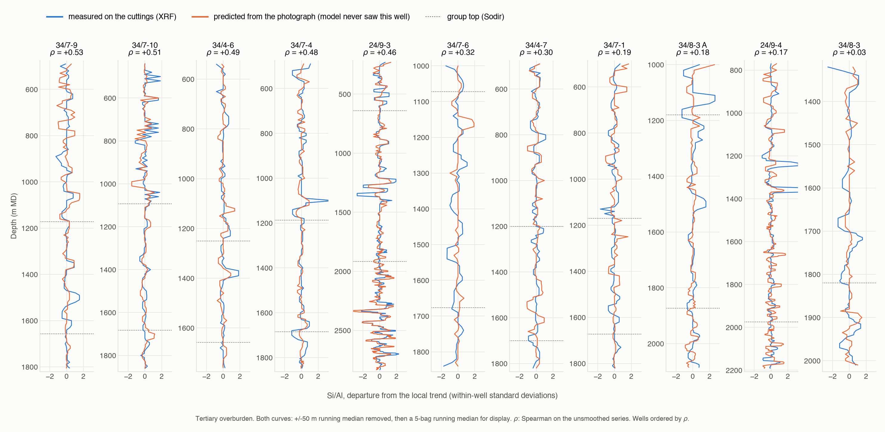

# What can a model learn from photographs of drill cuttings?

Code and results for the drill-cuttings part of the MSc dissertation
*Looking for Sinkites* (Gasim Mammadov, The University of Manchester,
2026), and for the tests run after it was submitted.

Eleven released Norwegian North Sea wells: 5,038 photographed cuttings
bags, handheld XRF on the same bags, wireline logs, mud logs and well
reports. **The data are not in this repository.**



*Each well held out in turn: the photographs predict how the Si/Al of the
cuttings moves along the hole, weakly but in all eleven wells.*

## Findings

| Question | Answer | Details |
|---|---|---|
| Can photographs separate sand from clay, with labels from gamma ray? | With three labelled wells, no (at chance). With ten, only at the scale of zones (median held-out AUC 0.73), and no better than depth within the well | [v3](docs/results/V3_RESULTS.md) |
| Can photographs predict the chemistry of the same bag? | **Yes, weakly, in every well.** Si/Al: median rank correlation +0.32 in 11 of 11 held-out wells. Fe, Ca and Ti over Al carry signal beyond Si/Al and mud, mostly through colour | [v7](docs/results/V7_RESULTS.md), [v8 A](docs/results/V8_RESULTS.md) |
| When does it work? | Where the chemistry varies: agreement follows the spread of Si/Al (+0.78 between wells), though this is not separated from measurement noise | [v8 B](docs/results/V8_RESULTS.md) |
| Does the prediction follow the wellsite geologist's sand percentage? | Weakly in the clay-rich Tertiary (+0.13). Below the Cretaceous, +0.50 (five locations; an amended, exploratory test) | [v7](docs/results/V7_RESULTS.md), [v8 D](docs/results/V8_RESULTS.md), [v9](docs/results/V9_RESULTS.md) |
| Does fine-tuning a network help? | No detectable gain over frozen features (three seeds) | [v8 C](docs/results/V8_RESULTS.md) |
| Can a colour or pellet detector find glauconite? | No. The dissertation's colour index is a green-hue index; a new detector fired on 22 % of Lista Formation bags | [corrections](docs/results/GLAUCONITE_CORRECTIONS.md), [v7](docs/results/V7_RESULTS.md) |
| Can photographs place stratigraphic tops in an unseen well? | No. Median error 65 m against 43 m for the nearest offset well | [v10 S](docs/results/V10_RESULTS.md) |
| What is the vertical resolution of cuttings? | Could not be measured with these wells | [v10 R](docs/results/V10_RESULTS.md) |
| Do the cuttings bear on the origin of the sands (sinkites)? | No evidence for; limited compositional evidence against a glauconitic Utsira source. The decisive test is age, and no sidewall cores exist | [v6](docs/results/V6_RESULTS.md) |

**Limits that apply throughout.** Eleven wells from two areas, used in every
round, so no result is a fresh hold-out. A bag mixes 3 to 10 m of hole and
includes cavings. The photographs also see drilling mud (they predict
barium). The mud-log labels were read by AI readers, with no human key.

## How the tests were run

Each test followed the same order, and every step is a commit:

1. A plan fixed the test, the statistic and the pass rule.
2. A reviewer criticised the plan, and the amendments were committed.
3. The code was committed before the run.
4. The test was run once; any deviation is written into the results file.
5. The reviewer checked every number against the saved result files.

The reviewer was an AI agent, not a person. Plans, results and notes are
indexed in [docs/](docs/README.md).

## Repository layout

```
├── README.md
├── CITATION.cff
├── requirements.txt           unpinned dependencies
├── requirements-lock.txt      exact versions used for the results
├── scripts/                   numbered in the order they run
│   ├── config.py              every path and parameter
│   ├── features.py            the 15 fixed colour and texture features
│   ├── 01_ … 24_              dissertation (v1)
│   └── 25_ … 72_              follow-up (v2 to v10)
├── results/                   tables and figures quoted in the results files
│   └── v2/ … v10/
└── docs/
    ├── plans/                 one plan per round, written before the run
    ├── results/               one results file per round, with the review
    ├── notes/                 thesis notes, thesis check, conference notes
    └── project_log.md         day-by-day record with commit hashes
```

## Reproducing the results

Python 3.13. On Apple Silicon, PyTorch uses the MPS backend.

```bash
pip install -r requirements-lock.txt
```

Set `SSD_ROOT` (the data drive, only read) and `WORK_DIR` (outputs) at the
top of `scripts/config.py`. Run every script from the repository root.
For the main result:

```bash
python scripts/25_v2_index.py
python scripts/26_v2_tiles.py
python scripts/27_v2_embed.py
python scripts/28_v2_features.py
python scripts/52_v7_photo_to_xrf.py        # photo -> Si/Al, leave one well out
python scripts/63_v8_elements_when.py A     # more elements
python scripts/65_v8_figures.py
```

Scripts write to `WORK_DIR`; the files that the results quote are copied to
`results/`.

| Round | Scripts | Results |
|---|---|---|
| v1, dissertation | `01` to `24` | at the tag [`v1-dissertation`](https://github.com/GasimMammad/cuttings-lithology-ml/tree/v1-dissertation) |
| v2, sand/clay in ten wells | `25` to `32` | `results/v2/` |
| v3, baselines and first XRF test | `33` to `41` | `results/v3/` |
| v4, core photographs (stopped at a reliability gate) | `42` to `49` | `results/v4/` |
| v5, adjudication by a panel of AI agents | `50` | `results/v5/` |
| v6, glauconite and the sinkite question | `51` | `results/v6/` |
| v7, photo to chemistry; pellet detector; Tertiary mud logs | `52` to `62` | `results/v7/` |
| v8, more elements; where it works; mud logs below the Cretaceous; fine-tuning seeds | `63` to `67`, `59` | `results/v8/` |
| v9, checks that close caveats | `68`, `69` | `results/v9/` |
| v10, stratigraphic tops and step response | `70` to `72` | `results/v10/` |

Two steps cannot be rerun from code alone. The mud-log tiles were read by AI
agents; their raw readings are saved in `results/v7/step3/readers/` and
`results/v8/readers/`. The search of the well reports in
`scripts/69_v9_k1_ocr.py` needs PyMuPDF and the macOS text recogniser in
`scripts/ocr.swift`.

## Use of AI

In the follow-up (v2 to v10) an AI assistant (Anthropic Claude, through
Claude Code) drafted the plans, wrote and ran the code, read the mud-log
tiles and the well reports, and acted as reviewer, under the author's
direction. The full statement is in
[docs/notes/THESIS_NOTES.md](docs/notes/THESIS_NOTES.md), sections 5 and 7e.
The dissertation carries its own, narrower declaration.

## Citation

See [CITATION.cff](CITATION.cff).

---

Gasim Mammadov · The University of Manchester · Supervisor: Prof. Mads Huuse
